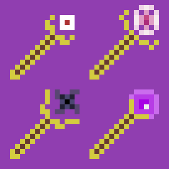

<div align="center">



# ✨ LordLox's Magical Wands

**A premier arcane spellcasting mod for Minecraft NeoForge 26.1**

[](https://www.minecraft.net/)
[](https://neoforged.net/)
[](https://adoptium.net/)
[](LICENSE.txt)

---

</div>

## 🌌 Overview

**LordLox's Magical Wands** brings high-tier spellcasting and dimensional magic to Minecraft 26.1. Forge mystical wands with unique physics-bending mechanics, interdimensional summoning portals, dangerous spacetime singularities, and high-stakes D20 fortune gambling.

Unlike standard tools, these wands cannot be crafted in a conventional 3x3 table—they demand an expanded **5x5 Wand Workbench** designed to channel raw arcane energy.

---

## 🪄 Wand Arsenal & Features

### 🛠️ 1. The Wand Workbench (5x5 Matrix)
* The gateway to all high-tier magic.
* Features an expanded **5x5 crafting matrix** and custom graphical user interface.
* Crafted on a standard 3x3 crafting table using Gold Ingots, Amethyst Shards, and Phantom Membranes.

---

### 🌌 2. Gravity Wand
*Manipulate the fundamental force of gravity around you.*
* **Right-Click**: Casts an antigravity shockwave launching all nearby entities skyward.
* **Shift + Right-Click (Gravitational Surge)**: Inverts the pulse, pulling all nearby entities directly toward you.

---

### 🕳️ 3. Black Hole Wand
*Tear open the fabric of spacetime.*
* **Right-Click**: Spawns an animated floating **Singularity (Black Hole Entity)** at the target location.
* Creates a gravitational vortex pulling surrounding entities into its event horizon and dealing relentless void damage.

---

### 🌀 4. Spawn Portal Wand
*Command interdimensional summoning rifts.*
* **Shift + Right-Click**: Opens an interactive **3D Mob Card Grimoire GUI**:
  * **Categorized Mobs**: Hostile, Passive, Neutral, Bosses, Aquatic, and Utility.
  * **Real-Time Search**: Quickly filter through registered creatures.
  * **Favorites System**: Star mobs and seamlessly cycle between them in-hand using **Shift + Mouse Wheel**.
  * **Dynamic Cost Matrix**: Displays diamond costs and spawn interval timers.
* **Right-Click**: Conjures an animated dimensional portal that continuously brings your selected creature into reality (consumes diamonds from inventory).

---

### 🎲 5. Gambling Wand (D20 Fate Die)
*Test your fortune with high-stakes probability magic.*
* **Shift + Right-Click**: Opens the **Gambler's Table GUI**:
  * Wager between **0 and 32 Diamonds** to skew the probability curve in your favor.
  * Higher bets eliminate critical fail penalties and substantially increase the odds of high-tier loot.
* **Right-Click**: Rolls the animated 3D D20 die with dynamic on-screen dice rendering:
  * **Natural 1 (Critical Failure)**: Calamitous doom!
  * **Low Rolls (2–7)**: Swarms of angry monsters.
  * **Medium Rolls (8–14)**: Friendly fauna or common mineral drops.
  * **High Rolls (15–19)**: Valuable mineral caches and rare resources.
  * **Natural 20 (JACKPOT)**: Explodes into fireworks and showers the player with a full stack of **64 Diamonds**!

---

## 📜 Crafting Recipes

### Wand Workbench (Standard 3x3 Table)
```
[Phantom Membrane] [   Gold Ingot   ] [Phantom Membrane]
[   Gold Ingot   ] [ Crafting Table ] [   Gold Ingot   ]
[ Amethyst Shard ] [   Gold Ingot   ] [ Amethyst Shard ]
```

### Wand Recipes (Inside 5x5 Wand Workbench)

| Wand | Arcane Core / Catalysts | Frame Material | Rod |
| :--- | :--- | :--- | :--- |
| **Gravity Wand** | 3x Amethyst Shards, 4x Phantom Membranes | 8x Gold Ingots | 4x Wooden Sticks |
| **Black Hole Wand** | 3x Echo Shards, 4x Phantom Membranes | 8x Gold Ingots | 4x Wooden Sticks |
| **Spawn Portal Wand** | 1x End Crystal, 2x Dragon's Breath, 4x Phantom Membranes | 8x Gold Ingots | 4x Wooden Sticks |
| **Gambling Wand** | 3x Diamonds, 4x Phantom Membranes | 8x Gold Ingots | 4x Wooden Sticks |

#### Wand 5x5 Pattern Structure:
```
[Membrane] [Catalyst] [Catalyst] [Catalyst] [Membrane]
[Membrane] [  Gold  ] [  Stick ] [  Gold  ] [Membrane]
[        ] [  Gold  ] [  Stick ] [  Gold  ] [        ]
[        ] [  Gold  ] [  Stick ] [  Gold  ] [        ]
[        ] [  Gold  ] [  Stick ] [  Gold  ] [        ]
```

---

## 📥 Download & Installation (For Players)

### Requirements
* **Minecraft**: `26.1`
* **Mod Loader**: [NeoForge 26.1.x](https://neoforged.net/) (`26.1.0.19-beta` or newer)
* **Java**: `Java 25` (standard Minecraft 26.1 bundled runtime)

### Installation Steps
1. Install **NeoForge 26.1** on your Minecraft launcher.
2. Download the latest `lordlox_magical_wands-1.0.0.jar` from the [Releases](https://github.com/LordLox/prova_mod/releases) page or CurseForge.
3. Place the downloaded `.jar` file into your `.minecraft/mods` folder.
4. Launch the game using the NeoForge profile.

---

## 💻 Building & Running from Source (For Developers)

### Prerequisites
* **Java Development Kit (JDK)**: Version 25 (e.g. Eclipse Adoptium Temurin 25)
* **Git** installed on your system

### 1. Clone the Repository
```bash
git clone https://github.com/LordLox/prova_mod.git
cd prova_mod
```

### 2. Build the Mod JAR
Compile the mod and assemble the release JAR artifact:
```bash
# On Linux / macOS:
./gradlew build

# On Windows:
.\gradlew.bat build
```
The compiled mod JAR will be located at:
`build/libs/lordlox_magical_wands-1.0.0.jar`

### 3. Launch the Client in Development
To test and debug the mod directly in a development environment:
```bash
./gradlew runClient
```

### 4. Other Useful Gradle Tasks
* **Run Dedicated Server**: `./gradlew runServer`
* **Run Data Generators**: `./gradlew runData`
* **Run Game Tests**: `./gradlew runGameTestServer`
* **Publish to Local Maven**: `./gradlew publishToMavenLocal`

---

## 🛠️ Project Structure

```
LordLoxs-Magical-Wands/
├── .github/workflows/          # GitHub Actions CI build workflow
├── src/
│   ├── main/
│   │   ├── java/com/lordlox/magicalwands/
│   │   │   ├── block/          # Wand Workbench blocks and blockstates
│   │   │   ├── client/         # Screens, Renderers, GUI overlays (D20, Portal Grimoire)
│   │   │   ├── entity/         # Black Hole & Spawn Portal custom entities
│   │   │   ├── gambling/       # Roll managers and probability calculations
│   │   │   ├── item/           # Custom wand items and interactions
│   │   │   ├── network/        # Client-Server network payloads
│   │   │   ├── portal/         # Mob configuration & registry
│   │   │   └── world/          # Menus and container management
│   │   ├── resources/          # Block/Item models, textures, JSON recipes, lang files
│   │   └── templates/          # neoforge.mods.toml metadata template
├── build.gradle                # NeoForge Gradle build configuration
├── gradle.properties           # Project & dependency versions
└── README.md                   # Mod documentation & guide
```

---

## 📦 Modpack & Video Policy

* **Modpacks**: You are free to include **LordLox's Magical Wands** in any public or private modpack on CurseForge, Modrinth, or custom launchers. Attribution is appreciated!
* **Content Creation**: You are fully welcome to showcase, review, or stream gameplay using this mod.

---

## 📄 License & Credits

* Developed by **LordLox**.
* For full terms, please refer to [LICENSE.txt](LICENSE.txt).
